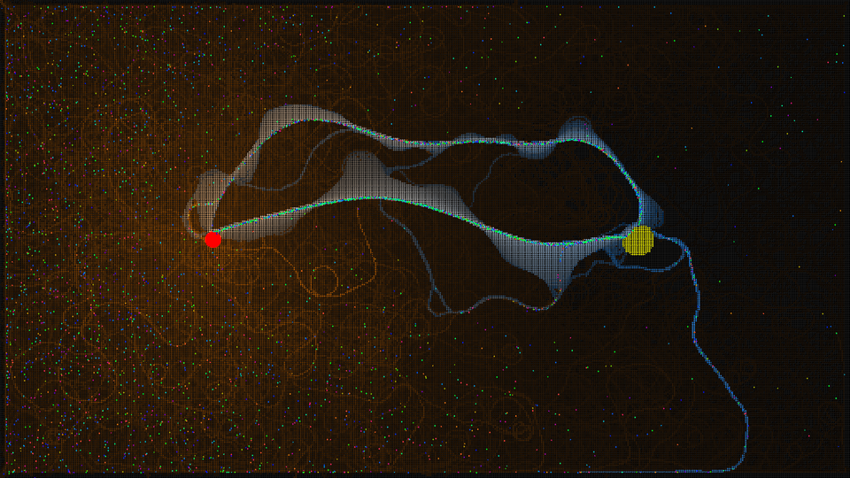
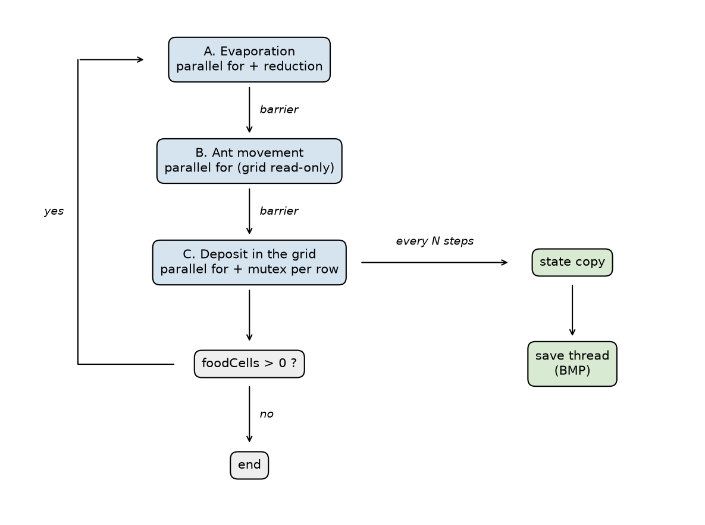
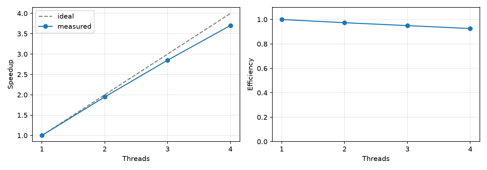

# Our project

{ width=55% }

- 5000 ants on a 512 x 288 grid
- They communicate only with pheromones, which evaporate
- Each ant scans 11 x 11 cells around it at every step
- The simulation stops when all the food is collected

# Where is the time spent?

Profiling of the sequential version with `perf`:

- `nextSimStep` (simulation): about 51 %
- `antGetDirectionSignal` (field of view scan): about 46 %
- SDL rendering: about 24 %

SDL has to stay on one thread, so we parallelized the simulation and added a headless mode for the Raspberry Pi.

# Dependency graph

{ width=60% }

# Shared data

| Data | Problem | Solution |
|---|---|---|
| grid in phase C | several ants on the same cell | one mutex per row |
| `rand()` | global state | one xorshift32 per ant |
| `foodCells` | concurrent increments | `reduction(+)` |
| state for the image | read while the simulation writes | copy + `pthread_join` |

# A bug found by our tests

- First version: `if (food > 0) food -= 0.02` inside the lock
- Two ants on the last piece of food: which one gets it depends on the threads
- Results were different from the sequential version after about 1700 steps
- Fix: check `onFood` in phase B, when the grid is read-only
- Downside: a cell can go slightly below 0

# Task parallelism

Every N steps:

1. wait for the previous save (`pthread_join`)
2. copy the simulation state
3. start a thread that writes the BMP image (`pthread_create`)

The simulation keeps running while the image is written.

# Tests

- `sequential/` and `parallel/` have the same sources, only `-fopenmp` changes
- The simulation is deterministic: fixed seed, one RNG per ant
- `make test` runs the full simulation and compares the final state with `cmp`
- Sequential and 1, 2, 3, 4 threads give exactly the same result

# Results on the Raspberry Pi 4

| Threads | Time (s) | Speedup | Efficiency |
|---|---|---|---|
| 1 | 368.7 | 1.00 | 1.00 |
| 2 | 189.3 | 1.95 | 0.97 |
| 3 | 129.4 | 2.85 | 0.95 |
| 4 | 99.5 | 3.70 | 0.93 |

Full simulation (6834 steps), headless, no images

# Speedup and Amdahl

{ width=85% }

Amdahl's law gives $f \approx 0.973$ with 2, 3 and 4 threads, so about 97 % of the program is parallel.

# What we did not do

- We did not try different problem sizes
- Each measurement was done only once
- We did not optimize the field of view scan (`atan2`)
- We did not compare OpenMP `schedule` options or other lock layouts
- With a single copy of the state, the simulation waits if saving is too slow (a FIFO like in Lab 2 would fix it)

# Thank you

Questions?
