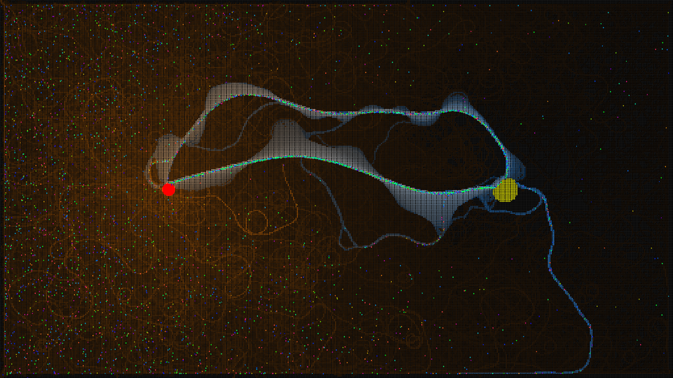
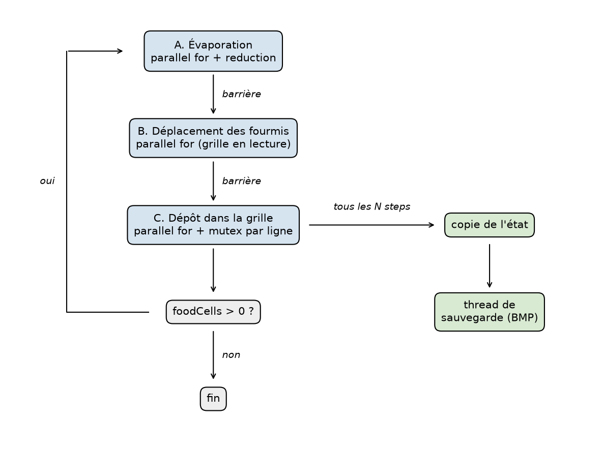
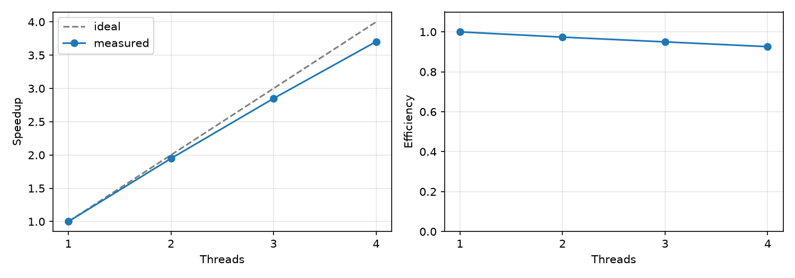

# Le problème

Notre projet est une simulation de colonie de fourmis. Les fourmis partent de la colonie, cherchent de la nourriture et la ramènent. Elles ne communiquent pas directement entre elles, seulement à travers des phéromones qu'elles déposent sur le sol et qui s'évaporent avec le temps. Au bout d'un moment, des chemins se forment entre la colonie et la nourriture.

{ width=75% }

Le monde est une grille de 512 × 288 cellules, avec 5000 fourmis. À chaque step, chaque fourmi regarde les cellules autour d'elle (rayon de 5 cellules, angle de vision de 120°). Si elle voit de la nourriture (ou la colonie quand elle en porte), elle va vers elle. Sinon, elle suit la cellule qui a le plus de phéromones, avec un peu d'aléatoire. Elle dépose ensuite un phéromone de type A si elle cherche, ou de type B si elle rapporte de la nourriture. Chaque passage sur une cellule de nourriture enlève 0,02 à cette cellule. La simulation s'arrête quand toute la nourriture a été récupérée.

Ce qui coûte le plus cher, c'est le scan du champ de vision : chaque fourmi parcourt un carré de 11 × 11 cellules à chaque step, avec un `atan2` par cellule pour calculer l'angle.

# Version séquentielle

Le programme est écrit en C. L'affichage utilise SDL3. Il y a deux modes :

- le mode fenêtré, pour voir la simulation en temps réel, avec le temps par frame et par step (moyenne, P95, P99) ;
- le mode headless, qu'on utilise sur la Raspberry Pi : `./bin/main <steps> [saveEvery] [dumpFile]`. Il n'y a pas de fenêtre. On peut sauvegarder une image BMP tous les N steps et écrire l'état final dans un fichier (pour les tests).

Un step (`nextSimStep`) est fait de trois phases :

A. l'évaporation des phéromones sur toute la grille, et le comptage des cellules qui contiennent encore de la nourriture ;

B. le déplacement de chaque fourmi (calcul de la direction, déplacement, puis on regarde si elle est sur de la nourriture) ;

C. le dépôt : chaque fourmi dépose son phéromone, prend de la nourriture ou la dépose à la colonie.

Dans notre toute première version, B et C étaient faits dans la même boucle, donc la fourmi `i+1` voyait déjà ce que la fourmi `i` venait de déposer. On a séparé les deux phases pour pouvoir paralléliser. Maintenant, toutes les fourmis voient l'état du step précédent. C'est cette version qui nous sert de référence.

Le dossier `sequential/` contient la version séquentielle et `parallel/` la version parallèle. Les sources sont les mêmes, seule la compilation change : `sequential/` est compilé sans `-fopenmp`, donc les `#pragma omp` sont ignorés.

# Analyse

## Profilage

On a d'abord profilé la version séquentielle avec `perf` (sur PC, en mode fenêtré). `nextSimStep` prend environ 51 % du temps, dont 46 % rien que pour `antGetDirectionSignal`, la fonction qui scanne le champ de vision. Le rendu SDL prend environ 24 %. Comme les appels SDL doivent rester sur un seul thread, on s'est concentré sur la simulation. C'est aussi pour ça qu'on a ajouté le mode headless : il permet de mesurer la simulation toute seule.

## Graphe de dépendances

{ width=75% }

La phase B a besoin des phéromones après évaporation, donc elle doit attendre la fin de A. La phase C utilise les nouvelles positions des fourmis calculées en B, donc elle doit attendre la fin de B. Dans les deux cas, on utilise la barrière implicite à la fin d'un `#pragma omp parallel for`. À la fin du step, le nombre de cellules de nourriture calculé en A décide si on continue.

## Données partagées

| Donnée | Qui y accède | Problème | Solution |
|---|---|---|---|
| grille (phase A) | chaque thread sur ses lignes | aucun | découpage du `for` |
| grille (phase B) | tous les threads, en lecture | aucun | personne n'écrit pendant B |
| grille (phase C) | plusieurs fourmis sur la même cellule | data race | un mutex par ligne |
| générateur aléatoire | `rand()` a un état global | pas thread-safe | un générateur par fourmi |
| `foodCells` | tous les threads | data race | `reduction(+)` |
| copie pour l'image | simulation et thread de sauvegarde | lecture pendant l'écriture | copie + `pthread_join` |

# Parallélisation

On a utilisé OpenMP pour les boucles, et pthreads (comme dans le Lab2) pour les mutex et le thread de sauvegarde. Le nombre de threads se choisit au lancement avec `OMP_NUM_THREADS`, sans recompiler.

## Phase A et réduction

L'évaporation est un `parallel for` sur les lignes de la grille. Dans la même boucle, on compte les cellules qui ont encore de la nourriture avec `reduction(+ : foodCells)`. Ce compteur est utilisé dans la boucle principale pour savoir si la simulation doit s'arrêter. On compte des cellules (un entier) plutôt que de sommer la nourriture (un float), parce qu'une somme de floats peut donner un résultat légèrement différent selon l'ordre des additions, et donc selon le nombre de threads.

## Phase B

Chaque itération ne modifie que sa propre fourmi et ne fait que lire la grille, donc il n'y a pas de conflit. Le seul problème était `rand()`, qui utilise un état global. On l'a remplacé par un xorshift32 stocké dans chaque fourmi. Ça règle le problème de concurrence, et en plus la simulation donne le même résultat quel que soit le nombre de threads.

## Phase C et mutex

C'est la partie où il y a de vrais accès concurrents. Plusieurs fourmis, traitées par des threads différents, peuvent être sur la même cellule. Les opérations `pheromone = fmax(force, pheromone)` et `food -= 0.02` lisent puis écrivent la cellule, donc deux threads peuvent s'écraser mutuellement.

On a mis un `pthread_mutex_t` par ligne de la grille (288 en tout). La fourmi verrouille sa ligne, fait ses écritures, puis déverrouille. Une seule section critique pour tout aurait sérialisé la phase. Un mutex par cellule aurait fait 147 456 mutex. Un mutex par ligne nous a paru être un bon compromis.

Nos tests nous ont fait trouver un problème dans notre première version. Le test `food > 0` était fait dans la section critique : quand deux fourmis arrivaient sur la dernière portion d'une cellule, une seule la prenait, mais laquelle dépendait de l'ordre dans lequel les threads prenaient le verrou. Le résultat divergeait de la version séquentielle à partir du step 1700 environ, et deux exécutions parallèles ne donnaient même pas le même résultat.

Pour corriger ça, on regarde maintenant si la fourmi est sur de la nourriture pendant la phase B (variable `onFood`), où la grille n'est que lue. En phase C, il ne reste que des écritures dont le résultat ne dépend pas de l'ordre (un `fmax`, et toujours la même soustraction). Le défaut est que si plusieurs fourmis arrivent en même temps sur la dernière portion, elles en prennent toutes une, et la cellule peut passer un peu en dessous de 0. On a accepté ce défaut pour garder un résultat déterministe.

## Parallélisme de tâches : la sauvegarde des images

Générer une image en 1920 × 1080 prend du temps. Au lieu d'arrêter la simulation pendant ce temps, on fait la sauvegarde dans un autre thread. Tous les N steps, le thread principal attend que la sauvegarde précédente soit finie (`pthread_join`), copie l'état de la simulation (`copySim`), puis lance un thread qui dessine et écrit l'image à partir de cette copie (`pthread_create`). La simulation continue pendant ce temps. La copie est obligatoire, sinon le thread de sauvegarde lirait la grille pendant que la simulation la modifie.

# Tests

Comme la simulation est déterministe (graine fixe et un générateur par fourmi), on peut comparer directement les résultats. Le script `parallel/test.sh` (`make test` dans `parallel/`) lance la simulation complète, jusqu'à ce qu'il n'y ait plus de nourriture, avec la version séquentielle, puis avec la version parallèle sur 1, 2, 3 et 4 threads. Il compare ensuite les fichiers d'état final octet par octet avec `cmp`.

Sur PC, les cinq exécutions donnent exactement le même état final. On a aussi vérifié que la sauvegarde des images ne change pas le résultat. Sur la Raspberry Pi, nous n'avons pas relancé `make test`, mais toutes les exécutions s'arrêtent bien au même step.

# Performances sur Raspberry Pi 4

Les mesures ont été faites sur la Raspberry Pi 4 (4 cœurs), en mode headless, sans sauvegarde d'images, sur la simulation complète (6834 steps), avec `OMP_NUM_THREADS=p ./bin/main 10000`. Chaque configuration n'a été mesurée qu'une seule fois.

| Threads | Temps total (s) | Step moyen (ms) | Step P99 (ms) | Speedup | Efficacité |
|---|---|---|---|---|---|
| 1 | 368,7 | 53,95 | 55,83 | 1,00 | 1,00 |
| 2 | 189,3 | 27,70 | 28,52 | 1,95 | 0,97 |
| 3 | 129,4 | 18,93 | 19,43 | 2,85 | 0,95 |
| 4 | 99,5 | 14,56 | 14,93 | 3,70 | 0,93 |

Le speedup est calculé par rapport à la version parallèle lancée avec 1 thread ($S = T_1 / T_p$), et l'efficacité vaut $E = S / p$. On n'a pas mesuré la version séquentielle sur la Pi.

{ width=95% }

Le speedup est presque linéaire : on obtient 3,70 avec 4 threads. L'efficacité baisse doucement, de 0,97 à 0,93. Le temps total est presque égal à la somme des temps de step (6834 × 14,56 ms donne 99,5 s), donc tout ce qui est en dehors de `nextSimStep` est négligeable. Le P99 est très proche de la moyenne, donc le temps par step est stable.

## Loi d'Amdahl

D'après la loi d'Amdahl, $S(p) = \frac{1}{(1 - f) + f / p}$, où $f$ est la fraction parallélisable. On peut donc estimer $f$ à partir d'un speedup mesuré :

$$f = \frac{1 - 1/S(p)}{1 - 1/p}$$

On trouve $f = 0,973$ avec 2 threads, $0,974$ avec 3 threads et $0,973$ avec 4 threads. Environ 97 % du programme est donc parallélisable. Avec cette valeur, le speedup ne pourrait pas dépasser environ 37, même avec une infinité de cœurs.

Cette estimation suppose que la partie parallèle se répartit parfaitement entre les threads, et elle ne tient pas compte de l'attente sur les mutex ni de la bande passante mémoire. Les parties séquentielles qui restent sont la boucle principale, la copie de l'état et le calcul des statistiques. Avec seulement 4 cœurs, on ne peut pas vérifier si le modèle reste valable au-delà.

L'efficacité et la fraction parallélisable ne mesurent pas la même chose : l'efficacité dit à quel point les threads sont bien utilisés pour un nombre de threads donné, alors que $f$ est une propriété du programme.

# Analyse critique

Le programme a trois phases parallèles qui dépendent les unes des autres, une réduction qui décide de l'arrêt, des accès concurrents à la grille protégés par des mutex et une tâche de sauvegarde qui tourne en même temps que le calcul. Les résultats sont identiques à la version séquentielle, et on obtient un speedup de 3,70 sur les 4 cœurs de la Raspberry Pi.

La plus grosse difficulté a été la race condition sur la nourriture. Elle n'apparaissait qu'après environ 1700 steps et on ne l'aurait pas vue sans les tests automatiques. On a aussi eu un bug dans notre générateur aléatoire : on divisait par `RAND_MAX` au lieu de `UINT32_MAX`, ce qui donnait des NaN puis une segfault. Enfin, il a fallu installer SDL3 sur la Raspberry Pi.

Il y a plusieurs choses qu'on n'a pas eu le temps de faire :

- on n'a pas fait varier la taille du problème (nombre de fourmis, taille de la grille), alors que c'était demandé ;
- chaque mesure n'a été faite qu'une fois ;
- on n'a pas optimisé le scan du champ de vision, alors que `atan2` prend une grosse partie du temps ;
- on n'a pas comparé les différents `schedule` d'OpenMP, ni d'autres façons de découper les verrous.

La colonie et la nourriture sont sur la même ligne horizontale, donc beaucoup de fourmis se retrouvent dans les mêmes lignes de la grille, ce qui pourrait créer de l'attente sur les mutex. On ne l'a pas mesuré, mais avec une efficacité de 0,93 cet effet semble faible. Avec la sauvegarde d'images, on a 4 threads OpenMP plus le thread de sauvegarde pour seulement 4 cœurs. Et comme on n'a qu'une seule copie de l'état, la simulation attend si une image prend plus de N steps à écrire. Une file de plusieurs copies, comme la FIFO du Lab2, réglerait ce problème.

# Compilation

```
make -C sequential                   # version séquentielle
make -C parallel                     # version parallèle
make -C parallel test                # tests de correction
cd parallel
OMP_NUM_THREADS=4 ./bin/main 0       # simulation complète sans images
OMP_NUM_THREADS=4 ./bin/main 0 500   # une image tous les 500 steps
```

Le projet dépend de SDL3 et SDL3_ttf, qui servent uniquement à l'affichage et à l'export des images, et de la police DejaVu Sans Mono (paquet `fonts-dejavu-core`). Sur la Raspberry Pi (Debian 13 trixie), tout s'installe avec `apt` :

```
sudo apt install build-essential pkg-config libsdl3-dev libsdl3-ttf-dev fonts-dejavu-core
```
